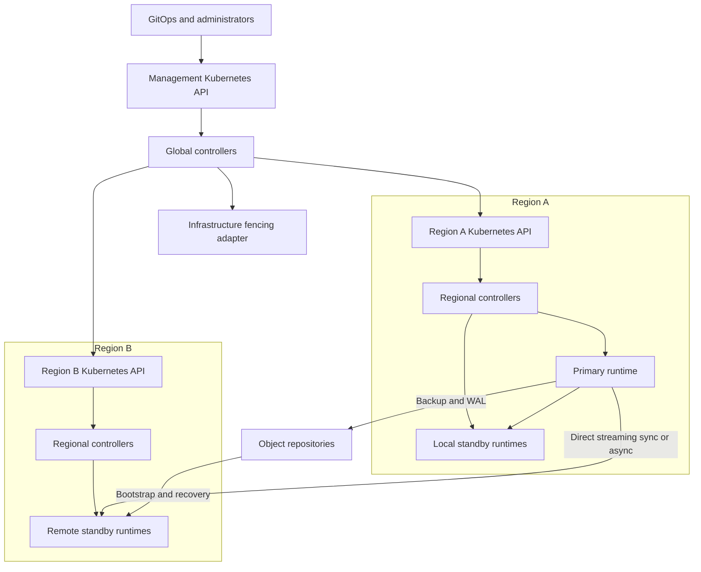
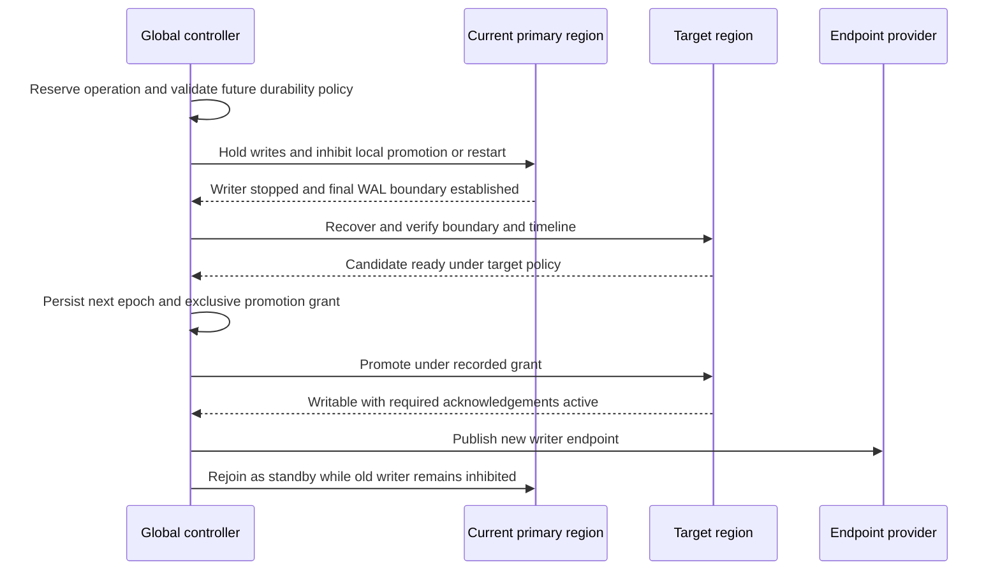

# PostgresManager Detailed Design

Status: Draft for engineering review

Date: 2026-11-03

Build one operator product that owns PostgreSQL lifecycle management in each Kubernetes cluster and coordinates database topologies across regions. Regional and global controllers share a codebase, image, API conventions, and release process. PostgreSQL replication and application connections run directly between database endpoints; the controllers do not proxy either traffic stream.

This design fixes the responsibility boundaries and safety requirements. The PostgreSQL HA runtime remains an implementation decision governed by the [runtime contract](runtime.md). No dependency on another PostgreSQL operator is proposed.

## Requirements and decisions

| Requirement | Design commitment |
| --- | --- |
| One writable primary | At most one authorized writable instance in each database topology. |
| Separate regional Kubernetes clusters | Each region has independent Kubernetes resources, storage, and regional management. |
| Synchronous and asynchronous replication | Explicit policies for remote acknowledgements, availability tradeoffs, and promotion eligibility. |
| Rolling changes and minor updates | Reload compatible changes; otherwise update replicas and perform a controlled switchover. |
| Live volume growth | Expand existing PVCs and verify filesystem capacity without planned pod replacement on certified storage. |
| Fast major upgrades | Offline in-place upgrade with preflight, recoverable backups, explicit commit boundaries, and replica recovery. |
| Fleet upgrades | Upgrade independent database topologies in controlled waves. |
| Backup, restore, and clone | Physical backups and continuous WAL archiving; restore to new resources by default. |
| Archive standby | Continuous recovery from S3 or GCS, with streaming optionally enabled. |
| Roles, credentials, and TLS | Declarative database access, Secret references, controlled rotation, and custom certificates. |
| AWS first | EKS, EBS CSI, S3, workload identity, and an AWS fencing implementation are the initial certification targets. |
| Cloud independence | Use Kubernetes storage APIs and capability-specific provider adapters. |

Proposed defaults are asynchronous cross-region replication, one synchronous local standby for production HA, requested regional failover with verified fencing, retained PVCs on deletion, and no automatic downgrade of durability. These are defaults for review, not additional user requirements. Development profiles may use one instance and must report that failover is unavailable.

Active-active writes, transparent transaction replay, automatic merging of divergent timelines, and zero-downtime physical major upgrades are outside the initial scope. The operator manages PostgreSQL on Kubernetes, including on-premises Kubernetes; managing databases directly on bare VMs is a separate scope.

## Terms and deployment model

A **topology** is one database dataset distributed across regions. A **regional cluster** is its set of PostgreSQL instances inside one Kubernetes cluster. An **instance** is a PostgreSQL process and its persistent storage. A standby region may elect a **replication ingress** to receive upstream WAL and serve cascading replicas; this role does not permit writes.

The binary supports three deployment modes:

| Mode | Enabled responsibilities | Placement |
| --- | --- | --- |
| `regional` | Instances, local HA orchestration, storage, configuration, credentials, backups, and regional operations. | Every participating Kubernetes cluster. |
| `global` | Topologies, regional assignments, global operations, and upgrade campaigns. | One designated management Kubernetes cluster. |
| `combined` | Both controller sets. | A management cluster that also hosts databases; useful for initial deployments. |

Each installation can have multiple replicas with Kubernetes leader election. Regional and global controller sets use distinct election identities and queues so they can be separated later without changing APIs. A single authoritative management cluster exists per topology; electing separate global leaders independently in every region is prohibited.

Multiple controllers can share manager clients and caches within an installation. Cross-cluster caches remain separate and bounded. See the [controller-runtime manager contract](https://pkg.go.dev/sigs.k8s.io/controller-runtime/pkg/manager).

Existing reads, writes, streaming, and WAL archiving do not need the global reconciliation loop on every transaction. Loss of management access suspends new global operations. In synchronous mode, promotions or acknowledgement-set changes also wait when the authoritative durability state is unavailable. This deliberately limits failover availability while preserving the stated durability contract.

## Controller ownership

| Component | Exclusive responsibility | Inputs and outputs |
| --- | --- | --- |
| Topology controller | Desired regional membership and topology initialization. | Renders regional cluster specs and assignments. |
| Global operation controller | Regional role transitions and topology-wide disruptive operations. | Reserves operation ownership, records epochs, issues scoped steps. |
| Campaign controller | Selection and scheduling of topology upgrades. | Creates one operation per selected topology. |
| Regional cluster controller | Instance inventory and Kubernetes resource lifecycle. | Creates pods, PVCs, Services, policies, and configuration. |
| Regional operation controller | Execution and observation of authorized regional steps. | Invokes the runtime, jobs, and fencing; reports durable results. |
| Backup controller | Backup scheduling, completion verification, and retention coordination. | Creates backup jobs and backup records. |
| Access controller | Managed SQL roles, databases, and credential publication. | Writes SQL only to the authorized primary. |
| Runtime | PostgreSQL process supervision and execution of its certified HA protocol. | Applies configuration, starts/stops, reports WAL state, and performs authorized promotions. |

The global controllers never mutate database pods, PVCs, or runtime configuration directly. They render a `PostgresCluster` spec or issue a `PostgresRegionAssignment`. Regional controllers are the only Kubernetes resource managers for that cluster. The runtime is the only component permitted to start or promote PostgreSQL.

For a globally managed cluster, users edit the topology template and regional overrides. Admission rejects direct edits to fields owned by global reconciliation. Standalone regional clusters remain supported. Adoption into a topology requires an explicit operation, identity checks, and a period with no conflicting operation.

Controller ownership is defined per field and resource. The runtime selection must also designate exactly one local election mechanism. A Patroni implementation, for example, cannot be combined with a second independent regional election algorithm.

## Cross-cluster control and authority

The first implementation uses a push model: global controllers access registered regional Kubernetes APIs using scoped clients. Each registration identifies the target API CA, a stable cluster identity, allowed namespaces, and an authentication reference. Private routing and workload identity are deployment prerequisites. A future pull transport can implement the same assignment protocol for environments that cannot expose regional APIs.

The management installation stores no database user passwords. Its regional permissions cover the operator CRDs and narrowly scoped discovery; access to database Secrets and pods is not part of the normal global role. Registration credentials are isolated by tenant or trust boundary. A caller cannot choose an arbitrary API endpoint or Secret through a topology manifest.

Three restricted internal resources make control state durable:

| Record | Location | Purpose |
| --- | --- | --- |
| `PostgresTopologyControl` | Management cluster | Authority identity, topology epoch, writer region, active operation, and committed durability configuration. |
| `PostgresRegionAssignment` | Regional cluster | Region role, topology identity, authority identity, epoch, desired revision, and authorized operation steps. |
| `PostgresClusterControl` | Regional cluster | Instance identities, PVC bindings, local writer term, runtime state, operation ownership, and durability evidence. |

These records are protocol state and must be backed up. They are not disposable caches that can safely be reconstructed from pod labels. Public status summarizes them. RBAC restricts protocol-state writes to the corresponding controller identity.

An assignment includes the topology UID, management authority ID, region ID, epoch, operation UID, step ID, expected local term, configuration hash, and preconditions. Commands are idempotent under that identity. Lower epochs, an unexpected authority, stale terms, and reused step IDs with different content are rejected.

Topology bootstrap creates the designated initial primary under an application write hold, establishes one database history, and bootstraps every other region from that history. Other regions never independently run initdb for the same topology. Required local and remote receivers must catch up and the effective durability configuration must be committed before application writes open. Administrative initialization runs only within this isolated bootstrap workflow.

Membership and role changes use uncached API reads and resource-version comparisons. Watches and cached observations trigger work but do not authorize promotion. Critical commands are checked against the current authoritative operation before execution. There is no cross-cluster transaction: operations advance through acknowledged steps and preserve uncertainty after a timeout.

Global controller leader election reduces duplicate work; conditional updates and runtime guards protect against delayed former controllers. Kubernetes client-go explicitly states that its election mechanism does not itself guarantee fencing. See the [leader-election implementation](https://github.com/kubernetes/client-go/blob/master/tools/leaderelection/leaderelection.go).

Moving the management authority is an administrative migration: stop the old coordinator, revoke its regional credentials, reconcile outstanding operations, verify all regional authority bindings, then activate the new authority. Restoring an old management backup does not automatically revive its grants. Epoch numbers from two independent restored authorities cannot establish mutual exclusion.

## Safety invariants

1. A topology has at most one authorized writer region, and that region has at most one writable instance.
2. A standby-region leader remains in PostgreSQL recovery until a global promotion operation authorizes otherwise.
3. A new writer is not activated until the previous possible writer has been stopped and prevented from restarting, or independently fenced.
4. A lease timeout, failed health check, removed Service endpoint, deleted Pod object, or DNS update is insufficient proof that a PostgreSQL process cannot write.
5. A synchronous promotion preserves all acknowledged commits covered by the policy, or remains blocked. The highest observed WAL position alone is not that proof.
6. An operation cannot silently lower replication durability, ignore a missing required region, or interpret missing status as healthy.
7. Only one incompatible disruptive operation runs on a topology at a time. Local HA may interrupt ordinary maintenance but must honor upgrade holds and durability requirements.
8. Restore, rewind, and upgrade commands operate on explicitly identified data directories and preserve recoverable source artifacts until cleanup is authorized.
9. A restarted controller can reconstruct its next action from durable state and observed effects without replaying an unsafe mutation.
10. A returning former primary is quarantined until it is rejoined as a standby or retained for explicit data recovery.

These invariants are release gates. An implementation that cannot establish a precondition reports a blocked condition instead of guessing.

## Reconciliation and operation execution

Controllers use Go and controller-runtime with bounded workers, event filtering, exponential backoff, and jitter. Each reconcile observes resources, evaluates invariants, computes one bounded change, applies it, and records the observation. Long-running commands execute in runtime tasks or Kubernetes Jobs rather than holding a reconcile worker.

Operation phases are `Pending`, `Validating`, `WaitingForWindow`, `Running`, `Verifying`, and one of `Succeeded`, `Failed`, `Cancelled`, or `NeedsIntervention`. `Blocked` is a condition with a reason, not a successful terminal state. Status records the current step, attempts, operation owner, configuration revision, evidence references, and timestamps.

Every mutating step has preconditions, an idempotency key, an observable postcondition, a timeout, and a stated recovery action. The controller records intent before execution. If the API call or runtime response is lost, it inspects actual state before retrying. For example, a successful promotion with a lost response is discovered from runtime identity and timeline, not followed by a second promotion command.

The topology reservation persists across controller crashes. A new leader resumes or investigates the same operation; a timeout does not automatically permit a conflicting operation. Cancellation is allowed only at documented safe points. After a promotion or an irreversible upgrade boundary, cancellation means stopping further steps and recovering deliberately.

Compatible work can proceed concurrently: metrics, observation, and ordinary WAL archiving continue during most operations. Backups, restores, membership changes, major upgrades, and failover use an explicit compatibility matrix. A major upgrade disables normal HA promotion before any data directory is modified.

## Instances and storage

The proposed regional implementation manages pods and PVCs directly. A durable instance ID survives pod replacement and binds to specific PVC UIDs. Roles never derive from an ordinal or pod name. The regional controller implements deliberate replacement and scale-down ordering instead of delegating PostgreSQL rotation to a generic workload rollout.

Data PVCs are operator-created and retained independently of pod lifetimes. Initial production storage uses one data PVC per instance, including WAL; a separate WAL PVC is a capability added with coordinated snapshot and recovery tests. Tablespaces require explicit, consistent mounts and are outside the first certified profile.

New instances bootstrap from a healthy source or a verified backup. Removal selects a non-writer outside the required acknowledgement set, updates membership safely, then stops its process. A lost node or uncertain attachment is fenced before its identity or volume can be reused. A single-writer volume access mode is useful but does not replace fencing.

Production placement spreads instances across nodes and availability zones. Requests, limits, scheduling constraints, disruption budgets, and termination grace periods are part of the cluster template. Disruption budgets are supplemented by runtime-aware maintenance checks; they do not govern all direct pod deletions or involuntary failures.

For expansion, the controller validates growth, patches existing PVC requests, and waits for both reported capacity and mounted filesystem size. A storage-only change does not alter the pod template. `RestartRequired` is reported if online expansion is unavailable; the operator does not silently restart to satisfy a no-restart request. Shrink requests are rejected. Storage-class changes require migration to new volumes.

Online expansion depends on the CSI driver, filesystem, and storage-class settings. The AWS profile certifies EBS CSI combinations rather than assuming every PVC can expand online. See [Kubernetes PVC expansion](https://kubernetes.io/docs/concepts/storage/persistent-volumes/#expanding-persistent-volumes-claims) and the [EBS CSI driver](https://github.com/kubernetes-sigs/aws-ebs-csi-driver).

## Replication and durability

### Data paths

Each physical topology uses compatible PostgreSQL major versions and a common database history. Streaming uses TLS over private regional endpoints. An archive-only standby uses a base backup plus WAL recovery and is always asynchronous. An instance counted as a synchronous acknowledgement must connect directly to the writable primary; downstream cascading replicas do not contribute an upstream synchronous acknowledgement. These are PostgreSQL constraints. See [standby and cascading replication](https://www.postgresql.org/docs/current/warm-standby.html).

The default asynchronous remote layout uses one ingress per standby region with optional cascading replicas. The synchronous layout designates a direct receiver in each required region. Additional receivers may be asynchronous. Changing ingress is a durability membership change when the ingress supplies required acknowledgements.

### Policy semantics

Local and remote policy are separate. `local.requiredStandbys` expresses required local durable copies. `crossRegion.mode` is `Asynchronous` or `Synchronous`. Synchronous policy names required standby regions; other regions may remain asynchronous. The policy also specifies requirements for each eligible future primary region so a switchover cannot remove the only required remote copy without an explicit policy decision.

The first synchronous implementation uses an exact acknowledgement set: the selected local standbys plus one selected direct receiver in every required remote region. All selected members must acknowledge. For example, one local standby and one remote receiver compile to `ANY 2 (local_member, remote_member)`. Including a second local member as an alternative would let both acknowledgements come from the primary region and is therefore forbidden. Arbitrary regional quorum expressions are deferred.

Names are derived from immutable instance identities, not reused regional aliases. The runtime verifies that replication connections match assigned instances. PostgreSQL's `ANY` count counts connections, not regions, and does not itself enforce unique standby names. See [synchronous standby configuration](https://www.postgresql.org/docs/current/runtime-config-replication.html).

Use `synchronous_commit=on` for durable remote WAL; `remote_apply` is optional when the application needs replay acknowledgement. Both require an effective nonempty synchronous standby set. Applications can override `synchronous_commit`, so durability claims cover transactions using the configured policy, not arbitrary session overrides. `remote_write` is not accepted for the durable-copy contract. See [PostgreSQL commit durability settings](https://www.postgresql.org/docs/18/runtime-config-wal.html).

Loss of a required receiver blocks policy-compliant commits. Asynchronous mode can keep writing during a WAN partition, but unreplicated transactions can be lost on disaster promotion. A configured lag threshold is an operational gate, not a hard data-loss bound while the source is unreachable. Unknown loss is reported as unknown.

### Acknowledgement membership changes

The first implementation serializes membership changes and briefly quiesces application writes instead of implementing a novel online quorum transition:

1. Reserve the operation and record the old and proposed sets in authoritative control state.
2. Enforce a write hold that stops new application sessions and resolves existing writers. A SQL default-read-only setting alone is insufficient. Runtime shutdown under a maintenance hold is the conservative implementation when a live gate cannot be proved.
3. Establish a final durable WAL boundary, including transactions with uncertain client outcomes. Verify the PostgreSQL system identity and timeline history.
4. Bring every member of the new set to that boundary. If required data or a member is unavailable, stop here.
5. Apply the exact new configuration, verify it, and durably commit the new configuration revision in both management and regional control state while writes remain held.
6. Release the write hold. After a crash in any earlier step, keep writes held until the effective configuration and journal agree.

For a globally synchronous topology, promotions and membership changes require the management authority to be available. Normal operation under a stable set does not. A more available protocol is a later design, with a proof and failure tests, rather than an implicit fallback.

### WAL retention and health

Physical slots and archive retention have bounded policies. Monitor retained bytes, slot validity, source WAL rate, remote receive/flush/replay positions, and observation age. Lost WAL can trigger archive catch-up or a controlled rebootstrap. Slot limits can invalidate a lagging replica and do not bound WAL retained for all other reasons, including failed archiving. See [PostgreSQL slot retention settings](https://www.postgresql.org/docs/current/runtime-config-replication.html).

Status distinguishes observed lag from promotion evidence. LSNs are compared only within a verified timeline history and database identity. Replayed transaction timestamps alone do not measure freshness on an idle database.

## Local HA and fencing

In an asynchronous remote topology, a regional runtime may perform automatic local failover under its certified protocol and current region assignment. It must fence the old writer and respect any local synchronous policy. In a globally synchronous topology, a promotion is coordinated with the authoritative acknowledgement configuration; it can block on management availability.

The local sequence is: detect failure, acquire operation ownership, identify the current term and durability revision, stop or fence the previous writer, establish candidate eligibility, bring the candidate to the required WAL boundary, authorize promotion, verify the new timeline and policy, and publish the writer endpoint.

Synchronous eligibility requires evidence that the candidate contains the acknowledged history. A recorded required member of an unchanged exact set can supply that history; a candidate outside the set must catch up from a verified durable holder. Missing or partially transitioned membership records cause `DurabilityProofUnavailable`. All known required durable copies being unavailable causes a lossless operation to block.

The runtime renews its local authority and stops writable PostgreSQL when local authorization is lost according to its certified protocol. Process stalls can defeat a software renewal loop, so a new writer still requires independently adequate fencing or confirmed process shutdown plus durable restart inhibition. A new process never starts writable using only a cached grant.

Fencing adapters return evidence bound to the topology, region, instance/node identities, authority epoch, operation, enforcement scope, and verification time. Regional fencing covers every instance that could become writable and prevents replacement infrastructure from reviving the old writer role. A completed Kubernetes deletion alone is not accepted as infrastructure evidence.

The first AWS fencing prototype should use dedicated database compute where stop/isolation and replacement inhibition can be verified. Shared-node installations must not stop unrelated workloads implicitly. If a deployment cannot provide effective fencing, automatic failover is unavailable and the operation waits for a verified administrative procedure. Merely changing security groups is not assumed to terminate all existing sessions.

## Regional switchover and disaster failover

### Planned switchover

Stopping applications at a proxy is helpful but is not the write fence. Existing database connections are drained or terminated by the runtime procedure. Clients must reconnect after the transition and handle transactions whose outcome was uncertain.

If the target cannot satisfy the future synchronous policy, promotion may remain administratively isolated until the required standby is rebuilt, or the operation remains blocked before promotion. The operator never advertises write readiness while policy-compliant commits cannot complete. A policy change to accept weaker durability must be separately authorized and recorded.

With two regions and a strict requirement for a remote durable copy after either region becomes primary, losing one region can preserve data while preventing write availability. A third region can supply a replacement copy if the future-primary policy names it and its recovery is verified. The operator reports this topology constraint before accepting the policy.

### Disaster failover

The initial policy requires an explicit `Failover` operation; automated detection produces conditions and alerts. The operation:

1. Reserves the topology, freezes conflicting maintenance, and identifies all possible old writers.
2. Establishes an effective regional fence. `AwaitingFencing` blocks promotion when this cannot be verified.
3. Evaluates target identity, timeline, available WAL, durability configuration, and the requested data-loss policy.
4. Recovers all required available WAL and records the evidence or the explicit acceptance of potentially lost transactions.
5. Advances the topology epoch, issues one promotion grant, verifies the new runtime role and future durability policy, then updates endpoints.
6. Quarantines the old region until it can safely rejoin.

`Lossless` requires proof. `AllowPotentialDataLoss` is a privileged operation setting with an audit reason; it does not waive fencing. Stale replication metrics cannot establish losslessness. DNS publication is tracked separately from database promotion because it can fail or converge slowly.

### Rejoin and failback

A returning former primary receives the new authority and standby role before its writer fence is removed. Rejoin verifies lineage, attempts rewind when prerequisites and WAL are available, and otherwise rebuilds from a new base backup. Preserve divergent data for investigation when loss was accepted. Failback is another requested switchover, not a preference-driven automatic reversal.

`pg_rewind` requires suitable hint logging or checksums and WAL history; a failed rewind can require a fresh rebuild. The operator initializes checksums, keeps `full_page_writes` enabled, and verifies prerequisites rather than assuming rewind is always possible. See [pg_rewind documentation](https://www.postgresql.org/docs/18/app-pgrewind.html).

## Backup, restore, and archive standby

The proposed first backup engine is pgBackRest. It supports S3, GCS, Azure, and filesystem repository configurations, letting the operator integrate one backup engine while certifying providers separately. The operator configures and orchestrates the engine; it does not implement physical backup formats. See the [pgBackRest user guide](https://pgbackrest.org/user-guide.html).

Backup policies define full/differential/incremental schedules, retention, repository references, encryption references, concurrency, and restore-verification frequency. A job succeeding is necessary but not sufficient: inspect the manifest, consistency checks, required WAL, and checksum findings before declaring `BackupReady`.

Repository identities include an immutable topology identity and database incarnation. Standby regions initially read the primary archive; exactly one authorized archive writer owns a shared stream. Region promotion transfers that ownership under the same fencing procedure. Major upgrades create a new archive incarnation. Independent clones receive a new repository prefix even if the physical restore retains the original PostgreSQL system identifier.

Configure WAL retention so an outage becomes an observable storage and availability problem rather than silently acknowledging discarded archives. In particular, pgBackRest's archive-push queue limit can drop WAL and break PITR; this behavior is not enabled by the production profile. See [pgBackRest archive queue behavior](https://pgbackrest.org/configuration.html#section-archive/option-archive-push-queue-max).

Restore creates a new `PostgresCluster` with new PVCs. The workflow validates source identity, backup integrity, version/extension compatibility, encryption access, and target; restores a base backup; replays the necessary WAL; verifies recovery completion; and creates replicas. Recovery target time or LSN has explicit timeline and inclusivity semantics. A missing WAL segment fails or blocks recovery; it does not cause promotion at an earlier point.

Archive-standby mode remains in recovery after available WAL is exhausted and retries for new WAL. Only an explicit promotion operation exits that mode. S3/GCS support follows the same repository contract. Backup plus a continuous WAL chain is necessary for PITR; retention must preserve that chain. See [PostgreSQL continuous archiving](https://www.postgresql.org/docs/18/continuous-archiving.html).

Backups intended for regional disaster recovery must be accessible outside the failed region. An S3 bucket reachable only through the primary region's unavailable dependencies is insufficient. Independently verify replicated repository contents, encryption keys, and recovery credentials before reporting a remote recovery point.

Snapshots are an optional acceleration path. A CSI snapshot does not, by itself, establish PostgreSQL application consistency or coordinate multiple volumes. The first guaranteed recovery path is the backup engine; a snapshot profile is enabled only with an explicit consistency and restore procedure. See [Kubernetes volume snapshots](https://kubernetes.io/docs/concepts/storage/volume-snapshots/).

## Configuration changes and minor upgrades

The planner classifies differences into reloadable settings, restart-required settings, pod replacement, storage growth, membership change, and major upgrade. Protected settings such as replication identities and authority-related runtime configuration are not arbitrary user overrides.

For a minor image update, validate image/extension compatibility, update asynchronous replicas in controlled batches, verify health and replay progress, safely rotate required synchronous members, switch to an updated eligible local standby, and update the former primary. Remote receivers are included in the plan. Standbys should be upgraded before the primary where supported by the release notes. See [PostgreSQL minor replication compatibility](https://www.postgresql.org/docs/current/warm-standby.html).

Each step respects maintenance windows, available replicas, acknowledgement requirements, and disruption limits. A single-instance cluster requires an outage. Synchronous member replacement may block writes or need a maintenance hold when no safe replacement exists; the rollout never silently changes policy to make progress.

TLS-only changes use validated atomic file replacement and reload where supported. Changing storage capacity does not trigger a rollout. Failed rollouts stop at the last verified step; reversing a minor image update requires a declared compatible path rather than an assumption that every image is reversible.

## Major upgrades and campaigns

An in-place major upgrade is a topology-wide maintenance operation. Validate the version pair, extensions, collations, binary compatibility, filesystem capabilities, available space, backup recovery, and `pg_upgrade --check`. Freeze writes and HA promotions across the topology before touching data. Preserve the shutdown WAL boundary and a tested recovery route.

Choose clone mode when the certified filesystem supports it; link mode requires explicit acknowledgement of its rollback boundary. PostgreSQL documents that starting the new cluster after a link upgrade makes the old shared data unsafe to restart. Physical replicas must follow a supported upgrade procedure or be rebuilt. See [pg_upgrade](https://www.postgresql.org/docs/current/pgupgrade.html).

The initial workflow upgrades the primary in isolation, rebuilds replicas, restores required durability, performs post-upgrade checks, and then enables application writes. A future optimized standby upgrade may shorten this interval after certification. Do not run independent major upgrades on physical replicas and assume their resulting catalogs are compatible.

Report two milestones: `DatabaseAvailable` and `ProtectionRestored`. The default requires both before declaring success and opening the writer endpoint. An explicit reduced-protection policy may allow earlier availability, but cannot silently override a synchronous requirement. Record a new backup/archive incarnation and take a new full backup. Pre-upgrade WAL cannot supply PITR across the version boundary.

If the new primary has accepted writes, restoration of the old backup discards those new changes unless separately recovered. Rollback policy records that consequence; it is not an automatic image change. Jobs with uncertain upgrade effects are investigated using directory markers and logs before any retry.

A campaign snapshots topology UIDs selected by namespace and labels, then schedules canaries and bounded waves. It selects complete topologies, not individual physical replicas. Each member gets a resumable operation, maintenance-window checks, timeout, and result. A failure pauses later waves by default. Already upgraded topologies are not automatically downgraded. Selector changes do not silently add targets mid-campaign.

A single-region database can be represented by a one-member topology and participate in the same campaigns. Standalone regional clusters support local upgrade operations; enrolling them in fleet management requires explicit adoption. Campaign planning lists its selected and excluded inventory so an unregistered cluster is not mistaken for an upgraded one.

GitOps ownership must be explicit: either the desired version is changed in Git before execution, or the campaign has delegated ownership of that version field. Field conflicts pause execution; the operator does not force-apply over an external owner.

## Credentials, TLS, and access control

Application roles are non-superuser by default. Declarative database ownership and role memberships are reconciled only at the current primary. The controller quotes identifiers safely and avoids SQL or log output containing passwords. It manages an explicit set of grants; unrelated DBA-managed privileges are not automatically removed.

Role catalog changes reach physical replicas through replication. Kubernetes Secrets do not. For a topology, credential material comes from an external secret system replicated into each approved namespace, or a dedicated credential-distribution integration with explicit scope. Regions cannot independently generate different passwords for the same replicated login. Global topology controllers handle references and version metadata only.

Password changes have a staged publication protocol and status showing database-applied and Secret-published versions. PostgreSQL has one password per login role; a seamless overlap requires rotating between login roles with inherited privileges and application support. The initial profile supports a maintenance-coordinated single-login rotation; dual-login rotation is an optional later feature. Deleting a manifest entry disables managed login access under policy and retains data; destructive role/database removal is explicit.

TLS covers client SQL, streaming replication, runtime management, and cross-cluster control. Custom certificate references include certificate/key and CA material. Validate key matching, expiry, hostname coverage, and trust before activation. Reload certificates atomically and retain the last usable material on failure. CA rotation uses a trust-overlap period followed by certificate replacement and final removal of old trust.

Runtime management endpoints require mutual authentication and reject arbitrary command execution. Service accounts, NetworkPolicies, private endpoints, non-root containers, restrictive filesystem permissions, and namespace-scoped RBAC are part of the supported deployment profile. Backup credentials are separate from application credentials. Kubernetes control state and Secrets require encrypted backups and an access policy suitable for the tenant boundary.

## Provider interfaces and AWS integration

Avoid a single broad `CloudProvider` abstraction. Each integration advertises capabilities and implements a small contract:

| Interface | Responsibility | First implementation |
| --- | --- | --- |
| `StorageCapabilities` | Inspect expansion/snapshot support and report verified outcomes; Kubernetes owns allocation. | PVC and EBS CSI inspection. |
| `RepositoryConfig` | Validate repository configuration and render backup-engine settings. | S3 with workload identity. |
| `WorkloadIdentity` | Bind an approved service account to provider credentials. | EKS identity integration. |
| `EndpointPublisher` | Publish and observe writer/read endpoint changes. | Service endpoints plus optional Route 53 integration. |
| `Fencer` | Plan, apply, verify, and release an effective fence. | Restricted AWS compute fencing profile. |

All mutating adapter calls take an operation identity and return observable receipts. `Unsupported`, `Retryable`, `PermanentFailure`, and `OutcomeUnknown` are distinct results. An adapter cannot report success solely because its API accepted a request.

The operator references existing Kubernetes clusters, VPC connectivity, storage classes, buckets, keys, and identity bindings. It does not provision a cloud account or create a regional network. Infrastructure prerequisites are installed through the platform's normal infrastructure tooling.

GCP and Azure add identity, repository, endpoint, and fencing implementations without branching the core state machines. On-premises uses a certified CSI driver, an S3-compatible or filesystem repository, and a fencing implementation such as an approved infrastructure management service. A storage provider lacking online expansion exposes that limitation directly.

## Endpoints and application behavior

Each regional cluster exposes distinct writer, reader, and replication endpoints. The writer endpoint is ready only when the instance has the authorized role and effective durability configuration. Reader readiness can include a configured lag limit; lagging readers are removed according to policy.

A global writer name points to the authorized regional writer endpoint. Endpoint publication follows database authority changes and cannot authorize them. DNS caches, connection pools, and existing sessions mean applications must reconnect and retry appropriately. The operator does not promise transparent exactly-once transaction retries. A later PgBouncer integration can manage pooling without changing the authority protocol.

Remote read endpoints may be stale in asynchronous mode. `remote_apply` acknowledgement applies to the required receivers, not every cascading read replica. Applications requiring read-after-write behavior must route accordingly.

## Observability and operating limits

Public status reports observed generation, per-region freshness, actual writer identity, authority epoch, runtime version, system identifier, timeline, received/flushed/replayed WAL positions, effective durability revision, last verified backup, and operation progress. `Ready`, `Available`, `ReplicationHealthy`, `DurabilitySatisfied`, `BackupReady`, `ProtectionRestored`, and `Degraded` have distinct meanings defined in the API document.

Expose metrics for reconciliation duration and errors, API throttling, cache size, queue depth, operation age, WAL retention, replication lag, synchronous commit waits, backup freshness, restore verification, PVC usage, certificate expiry, and fencing outcomes. Keep per-operation identifiers in structured logs rather than unbounded Prometheus labels.

Alerts cover unavailable write service, missing synchronous members, stale region observations, failed archiving, near-full volumes, invalid slots, failed backups, stuck operations, certificate expiry, and possible authority conflicts. Audit events record requester, target UIDs, source/target epochs, policy changes, loss acceptance, and fencing evidence without secret values.

Recovery point objective is the amount of data an accepted recovery may lose; recovery time objective is the time to restore useful service. Async RPO is observed, not guaranteed from a stale lag sample. Sync guarantees are limited to policy-compliant acknowledged transactions and surviving required durable history. RTO includes fencing, WAL replay, client reconnection, and restoration of required acknowledgements. Numeric SLOs are set after workload and failure benchmarks.

Bound cached resource types and namespaces. Use per-cluster client limits, per-topology operation queues, and provider concurrency limits. A regional API outage must not starve other regions' observations. Benchmark controller resource usage independently from database throughput before deciding to split global and regional deployments.

## Failure behavior

| Failure | Required behavior |
| --- | --- |
| Global operator restart | Resume durable operations; no duplicate promotion or upgrade. |
| Management API unavailable | Stable data paths continue; global transitions and required sync membership changes wait. |
| Regional operator unavailable | Runtime behavior follows its certified local protocol; ordinary Kubernetes reconciliation pauses. |
| Regional Kubernetes API lost | Runtime follows local authority-loss rules; no new writer is assumed safe from API absence alone. |
| WAN partition under async policy | Current primary may continue writing; remote state becomes stale; no timeout-only remote promotion. |
| WAN partition under sync policy | Required commits block; no automatic async fallback. |
| Old writer node suspended | New writer waits for an effective fence or verified shutdown. |
| Remote ingress lost | Replace only after data and membership checks; cascaded replicas are not presumed current. |
| Archive repository unavailable | Alert and retain WAL under policy; no fabricated archive success. |
| Credential rotation interrupted | Preserve progress and reconcile database/Secret versions before proceeding. |
| Promotion succeeded but response lost | Observe actual role, grant, and timeline; resume the same operation. |
| Region returns with old epoch | Quarantine, update assignment, and rewind/rebuild before removing its fence. |
| Upgrade partially modified data | Maintain write and HA holds; report `NeedsIntervention` and follow the recorded recovery route. |

## Deletion and disaster recovery of control state

Deleting a topology first disables new operations, stops or transfers writer authority, and removes regional assignments through acknowledged steps. The default retains PVCs, backups, and recovery metadata. Deleting a Kubernetes object is never the implicit authorization to delete database storage or object repositories.

PVC retention across cluster-resource deletion does not protect against namespace deletion or a storage administrator deleting the volume. Production retention profiles must also define PV reclaim behavior, storage access controls, and independent backups. The operator exposes the effective storage policy rather than claiming its finalizer protects every deletion path.

Finalizers must expose progress and blocked reasons. Forced finalizer removal is a documented administrative recovery action that can orphan resources; it does not prove the database stopped. Cross-cluster resources use explicit identity and deletion workflows because Kubernetes owner references do not span independent clusters.

Management and regional control records, CRDs, identity bindings, and secret-recovery procedures are included in platform disaster recovery. After restoration, observe databases in read-only control mode, reconcile epochs and outstanding commands, and verify authority before allowing new mutations. Loss of control metadata may require fencing all possible writers and re-establishing authority from verified database history.

## Implementation boundaries

Proposed packages are `api`, `controllers/regional`, `controllers/global`, `operations`, `runtime`, `replication`, `backup`, `providers`, `security`, and `observability`. The command exposes deployment mode and scope; it does not select arbitrary untested runtime plugins.

The operation planner and safety predicates should be testable independently of Kubernetes clients. Provider and runtime interfaces isolate side effects for deterministic failure injection. Initial implementation certifies one runtime, one PostgreSQL version pair, and one AWS storage/fencing profile. The [delivery plan](delivery-plan.md) defines the gates before expanding that matrix.
